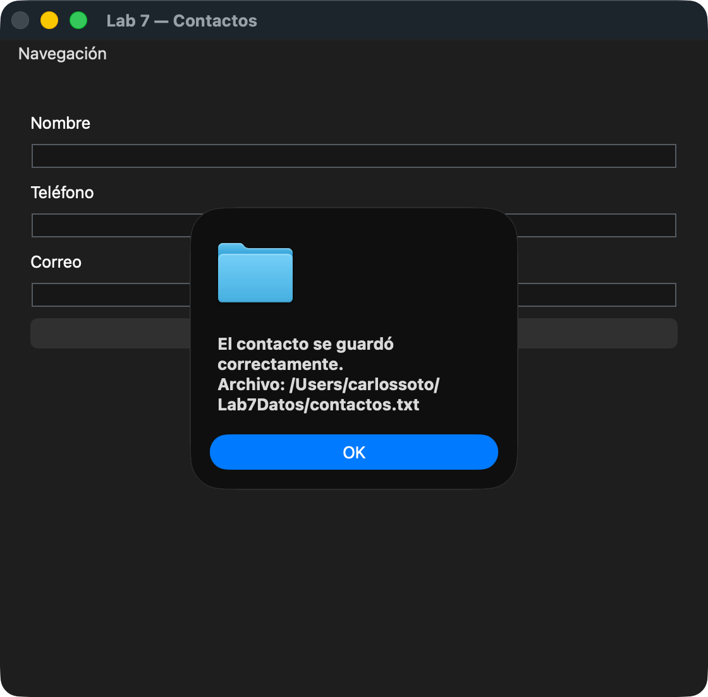
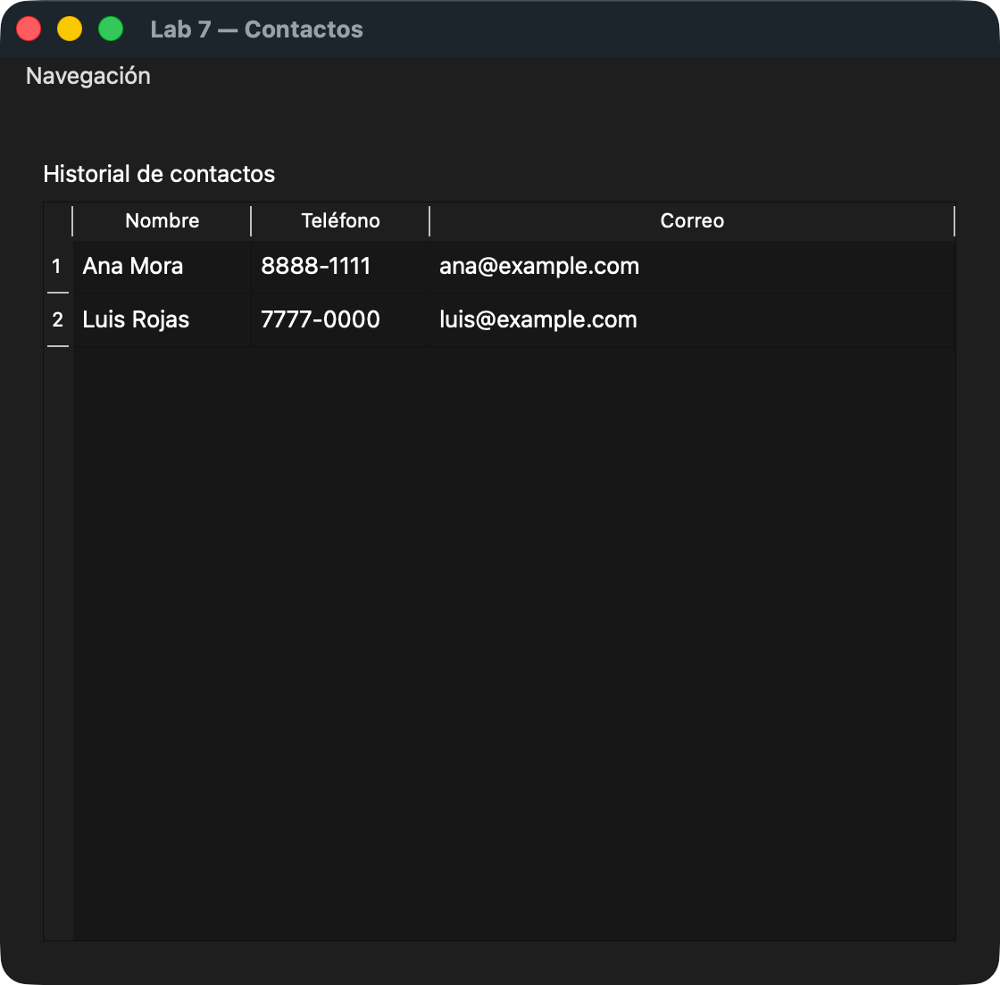

# Lab 7 - Programación 1

Agenda de contactos hecha con Qt. Se escribe el nombre, teléfono y correo, se le da a Guardar y el contacto queda en un archivo .txt. Con el menú Navegación se puede ver el historial, editar y eliminar contactos.

Carlos Soto - EIF201

## Cómo compilar

Lo hice en Mac, entonces en vez de Visual Studio usé CMake con Qt 6 (el proyecto está en la carpeta `Lab7`). Se puede abrir el `CMakeLists.txt` con Qt Creator o compilar así:

```
cd Lab7
cmake -S . -B build
cmake --build build
```

## Ruta del archivo

`~/Lab7Datos/contactos.txt` (en mi compu queda en `/Users/carlossoto/Lab7Datos/contactos.txt`, en Windows sería `C:/Users/usuario/Lab7Datos/contactos.txt`). Cada línea es `nombre;telefono;correo`. En `contactos-ejemplo.txt` está como me quedó el archivo al final.

## Cómo probé editar y eliminar

- Guardé 3 contactos: Ana Mora, Luis Rojas y María Solís. En Historial salieron los 3.
- En Editar le di Guardar cambios sin escoger fila y me salió el aviso. Después escogí a Luis y le cambié el teléfono a 7777-0000, y en el txt solo cambió esa línea.
- En Eliminar escogí a María, le di que No y no se borró nada. Después le di que Sí y se borró solo ella del txt y de la tabla.
- Cerré y abrí la app otra vez y quedaron Ana y Luis con el teléfono nuevo.
- También probé con el historial vacío y dejando un campo vacío, y no se cayó ni guardó nada raro.

## Capturas

Guardado con confirmación:



Historial final:


